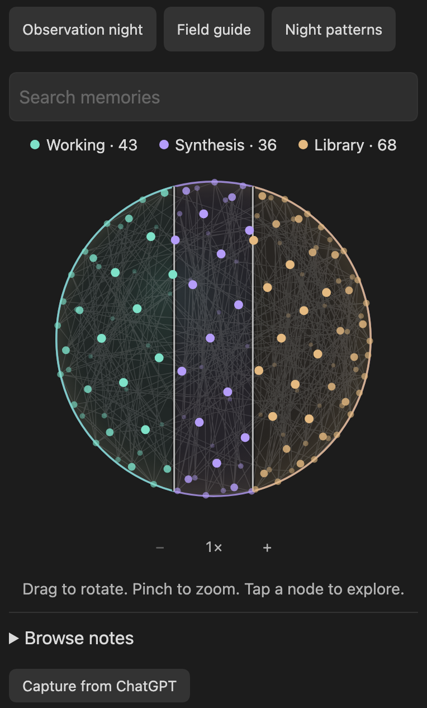
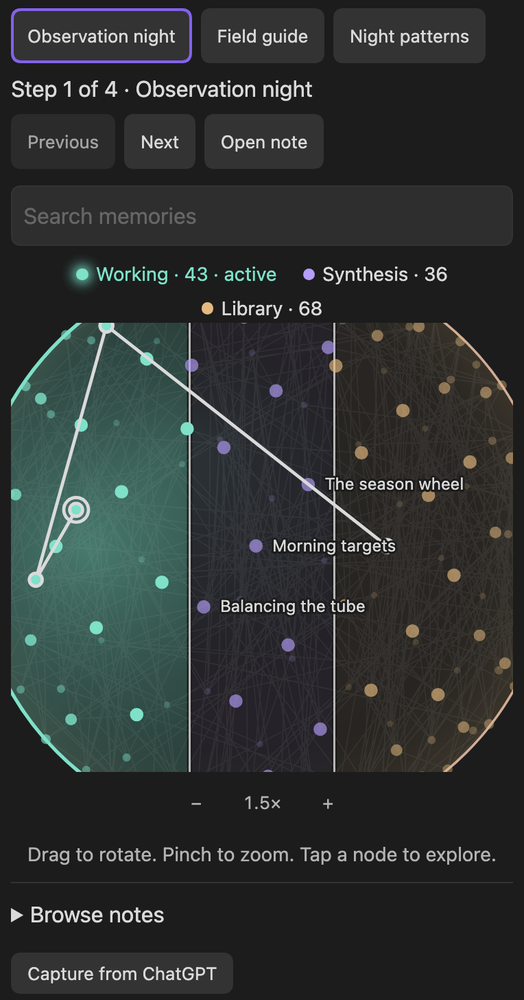
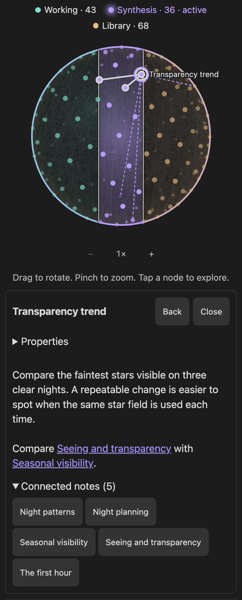

# Memory Orb

Memory Orb places your Obsidian notes on a sphere you can turn, search, and read. Each dot opens a Markdown note. A line between two dots comes from a link Obsidian has resolved between those notes. The orb refreshes as you add, edit, rename, delete, or link notes.

Working, Synthesis, and Library share one surface. Colored borders mark their boundaries, and the active region lights up as you explore.



## Put an orb in a note

Install and enable the plugin, then paste this fenced block into any note. Open the note in Reading view to use the orb.

````markdown
```memory-orb
```
````

Your existing Markdown notes appear automatically, including notes with no links. A note with a `title` property uses that title in the orb. Other notes normally use their filename.

## Explore and read

| To do this | On a phone | With a keyboard |
| --- | --- | --- |
| Turn the sphere | Drag with one finger | Focus the orb and use the arrow keys |
| Zoom from 1× to 8× | Pinch around a node or tap **+** and **−** | Use **+** and **−** |
| Move the magnified view | Slide two fingers together | Use **Shift** and an arrow key |
| Return to the starting view | Tap the current zoom value | Press **0** |
| Read a note | Tap a node or choose its name under **Browse notes** | Tab to a note in the list and press **Enter** |

At higher magnification, labels help you distinguish nearby nodes. Choosing a note highlights its real connections. Search matches titles, paths, aliases, tags, headings, and locally available note text. The result list contains direct matches. Their immediate neighbors appear on the sphere so you can follow a connection beyond your search.



The reader opens beneath the sphere. Follow a wikilink in the text or expand **Connected notes** to see both incoming and outgoing links. **Back** retraces your reading history. **Close** returns you to the orb. The reader shows note text, folds leading YAML properties, and displays code, HTML, and embeds as text.

## Choose a region

| Region | What belongs there | How a note gets there |
| --- | --- | --- |
| **Working** · teal | A current experiment, a question to resolve, or an idea you are developing | Set `memory_region: short`. Notes in `_raw/` or `Notes/Inbox/` also default to Working. |
| **Synthesis** · violet central band | A comparison, pattern, or decision that connects several ideas | Set `memory_region: synthesis` or place the note below the vault’s top-level `synthesis/` folder. The folder name is case-insensitive. |
| **Library** · amber | A reference, a settled decision, or knowledge you expect to reuse | This is the default. Set `memory_region: long` to keep a note here explicitly. |

These properties go in the note’s YAML frontmatter. A pathway note’s own `memory_pathway` value selects its region. On other notes an explicit `memory_region` takes precedence over folder or pathway membership. If your vault uses `projects/project-hub.md`, links under its `## Active` heading also identify Working notes. These folders and notes are optional.

## Follow a pathway across regions

A pathway is a note with a `memory_pathway` property and an ordered sequence of wikilinks under `## Steps`. The pathway note itself is the first stop. Each hop must join two notes with an existing Obsidian link in either direction.

For example, these two garden notes can already exist in your vault.

**Balcony trial.md**

```markdown
---
memory_region: short
---
The shaded pot stayed damp for two extra days. See [[Soil moisture check]] for the test.
```

**Soil moisture check.md**

```markdown
---
memory_region: long
---
Check the soil below the surface before choosing the next watering day.
```

Add a third note, **Watering pattern.md**, to connect the observation and the reference.

```markdown
---
memory_pathway: synthesis
---
Adjust the watering interval to match soil conditions.

## Steps

1. [[Balcony trial]]
2. [[Soil moisture check]]
```

Select **Watering pattern** above the orb, then **Next**. The first hop opens **Balcony trial**. Its own link makes the next hop to **Soil moisture check** possible. The three stops keep their Synthesis, Working, and Library colors. A missing note or an unlinked pair produces a message identifying the step to fix.

You can create multiple named pathways with `short`, `long`, or `synthesis`. Working pathways also mark otherwise unassigned steps as Working. Library and Synthesis pathways can visit notes in any region.



## Capture from ChatGPT

Choose **Capture from ChatGPT** on the orb or in the command palette. Paste the passage you want to keep, review its title and region, and choose **Save memory**. If a note is open in the orb, you can link the capture to it. Captures are saved under `Notes/ChatGPT memories/`. Saving the same passage again finds the existing capture.

A shortcut can open the same review form through the Obsidian URI below. URL-encode the `title` and `text` values. The example opens a draft and waits for you to save it. Paste private material in the app if you want to keep it out of a shortcut URL.

```text
obsidian://memory-orb-capture?title=Soil%20check&text=Check%20below%20the%20soil%20surface.
```

The plugin reads the open vault through Obsidian. It makes no external network requests and has no access to your ChatGPT account. Your vault’s existing sync service can still sync notes and plugin files.

**Optional scheduled summaries.** A separately configured local Codex task can supply summaries to `companion/sync.py`. The helper takes JSON from standard input or a named file. Its `baseline` command records IDs from both the active and archived catalogs, `pending` identifies new or changed post-baseline conversations, and `save` writes a short summary to one Markdown note per conversation. It checks for manual changes before updating its managed text. You supply the history access, schedule, vault location, and private state directory separately. The plugin install enables none of those services.

## Verify and install 1.1.0

The manifest requires Obsidian **1.5.0 or later**. The release offers `memory-orb-1.1.0.zip` and the individual `main.js`, `manifest.json`, and `styles.css` files. [Download release 1.1.0](https://github.com/M4GiK93/memory-orb/releases/tag/1.1.0)

1. Download the zip, `SHA256SUMS`, and `SHA256SUMS.sig` into one folder. Get the `SIGNERS` file from a copy of this repository that you already trust and place it in that folder.
2. In that folder, verify the signature using OpenSSH. The signer identity is `chris-mir` and the signing namespace is `memory-orb-release`. [OpenSSH signature verification](https://man.openbsd.org/ssh-keygen)

   ```sh
   ssh-keygen -Y verify -f SIGNERS -I chris-mir -n memory-orb-release -s SHA256SUMS.sig < SHA256SUMS
   ```

3. After verification succeeds, check the zip against the signed manifest. On macOS, run the command below and look for `memory-orb-1.1.0.zip: OK`. On Linux, `sha256sum -c -` can replace `shasum -a 256 -c -`. If you downloaded every file in the manifest, you can check them all with `shasum -a 256 -c SHA256SUMS`.

   ```sh
   awk '$2 == "memory-orb-1.1.0.zip" || $2 == "*memory-orb-1.1.0.zip"' SHA256SUMS | shasum -a 256 -c -
   ```

4. Unpack the verified zip. Place `main.js`, `manifest.json`, and `styles.css` directly inside `.obsidian/plugins/memory-orb/` under your vault. If you use a custom Obsidian configuration folder, substitute its name for `.obsidian`.
5. Open or reload that vault. In **Settings → Community plugins**, enable community plugins and turn on **Memory Orb**. For a synced iPhone vault, confirm the plugin files reached the vault and that Memory Orb is enabled on the phone. Then open the note containing the fenced block.

## Build and test

From the repository root, use Node.js 22 or later. The build uses Node built-ins and requires no package installation.

```sh
node build.js
node test-graph.js
node test-pathways.js
node test-zoom.js
node test-capture.js
node test-inspector.js
```

The build writes the three plugin files to `dist/`. The inspector test launches a local Chrome or Chromium browser with a temporary profile. Set `CHROME_BIN` to the browser executable if it is installed in a different location.

The optional companion’s tests use Python 3.9+ on macOS or Linux and an isolated temporary vault.

```sh
python3 -IB -m unittest discover -s companion -p 'test_sync.py'
```

## License

Copyright © 2026 Chris Mir. [MIT License](LICENSE)
